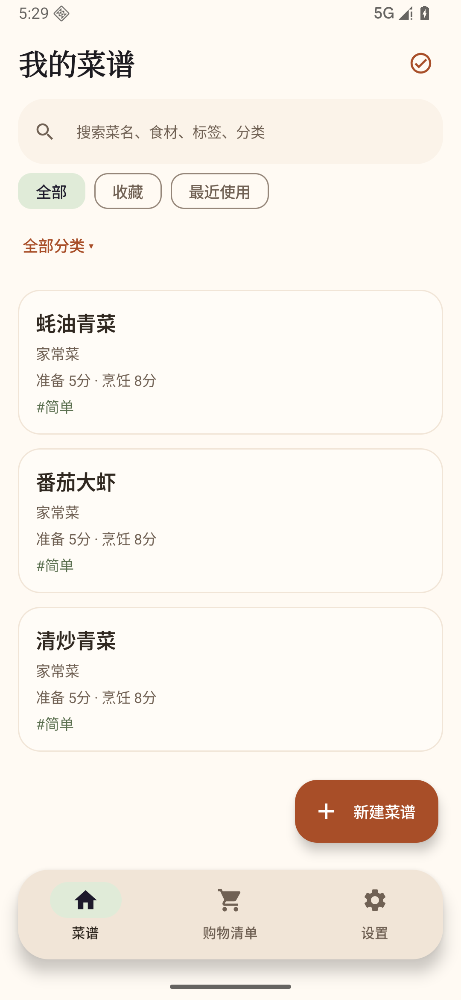
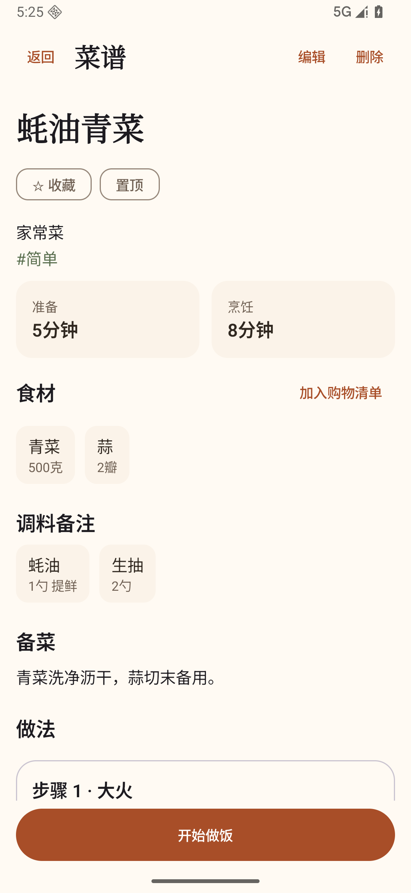
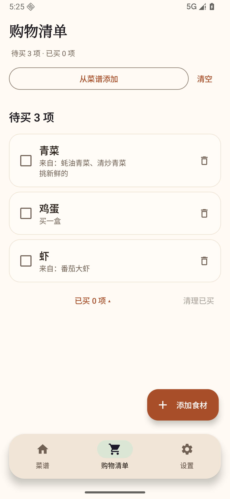

<div align="center">

[简体中文](README.md) | [繁體中文](README.zh-TW.md) | English

# Cove Recipe

**An offline, local-first Android personal recipe book with kitchen mode, cooking timer, source-tracked shopping list, and full ZIP backup.**

[](https://github.com/vanvan-program/cove-recipe/releases/latest)
[-3DDC84?style=flat-square)](#installation--data-safety)
[](#tech-stack--project-structure)
[](LICENSE)

[Download APK (Releases)](https://github.com/vanvan-program/cove-recipe/releases) · [Changelog](CHANGELOG.md) · [Third-Party Notices](THIRD_PARTY_NOTICES.md) · [Issues](https://github.com/vanvan-program/cove-recipe/issues)

</div>

---

## Overview

**Cove Recipe** is a Chinese-first, completely offline, local-first Android personal cookbook (minSdk 26 / Android 8.0, targetSdk 36 / Android 16). Built purely for personal cooking workflows: **no account, no network permission, no ads, and no cloud sync**.

> [!TIP]
> Detailed release notes (`1.1.0` – `1.4.0`) have been organized into **[CHANGELOG.md](CHANGELOG.md)**.

## Screenshots

Captured from the `1.4.0` emulator test suite using sample recipe data:

<p>
  
  
  
</p>

## Key Features

- **Structured Recipe Book**:
  - Store cover photos (compressed to ~1600px max edge in private storage), structured **ingredients**, **seasoning notes**, **prep instructions**, reorderable steps, heat levels, and step timers.
  - Drag-and-drop manual ordering (preserving pinned groups + accessibility move actions), up to 3-level categories, freeform tags, unified search, favorites, pins, and recently used recipes.
- **Kitchen Mode & Global Cooking Timer**:
  - Large typography, keep-screen-on, step-by-step navigation, and quick ingredient/seasoning overlay while cooking.
  - Monotonic-clock global countdown timer (1s – 7d via H/M/S wheel picker) with live notification countdown and continuous vibration alert on completion until acknowledged.
- **Source-Tracked Shopping List**:
  - Add ingredients and seasonings from recipe details, multi-select on home, or directly inside the shopping list; duplicates merge automatically while listing all source recipe names.
  - Supports buying notes, checked state, and undo on delete.
- **Strict ZIP v3 Backup & Restore**:
  - Single-file ZIP archive bundling recipes, categories, tags, shopping list, and cover images (backward-compatible with v1/v2).
  - Validates schema version, referential integrity, size limits (JSON ≤ 16 MB, image ≤ 32 MB, total ≤ 256 MB), and image paths before atomically replacing the database inside a transaction.

## Installation & Data Safety

- Download from [GitHub Releases](https://github.com/vanvan-program/cove-recipe/releases) or build `app/build/outputs/apk/debug/app-debug.apk` (also copied to `dist/CoveRecipe-1.4.0.apk` by the PowerShell script).
- Package name: `cn.myrecipe.app`. Upgrade in place with the same signing key without uninstalling; always export a ZIP backup first (Android cloud backup and device transfer are disabled).
- Grant **Notifications** and **Exact Alarms** for reliable background cooking timers. Exported ZIP backups are unencrypted—store them safely.

## Tech Stack & Project Structure

- **Stack**: Kotlin `2.0.21` · Jetpack Compose (BOM `2025.02.00`) · Material 3 · Room `2.6.1` (DB v3 with explicit migrations) · Navigation `2.8.9` · DataStore `1.1.3` · AGP `8.9.2` · Gradle `8.11.1`
- **Architecture** (single `app` module):
  - `core` — Room database, image storage, timer service, ZIP backup contract, and theming
  - `data/repository` — Local repositories
  - `feature` — Recipes, Editor, Kitchen Mode, Shopping List, Categories/Tags, and Settings (ViewModel + StateFlow)

## Building & Testing

- **Requirements**: JDK `17+` · Android SDK `36` · Gradle `8.11.1`

```powershell
git clone https://github.com/vanvan-program/cove-recipe.git
cd cove-recipe
.\gradlew.bat :app:assembleDebug :app:testDebugUnitTest :app:lintDebug
```

- On macOS / Linux, use `./gradlew`. With a local `.tools/` cache, run `.\scripts\build.ps1 -Offline` (add `-DeviceTests` for emulator tests). See `docs/1.4.0验证.md` for test notes.

## License

Licensed under the **[MIT License](LICENSE)**. Third-party attributions are listed in [THIRD_PARTY_NOTICES.md](THIRD_PARTY_NOTICES.md).
