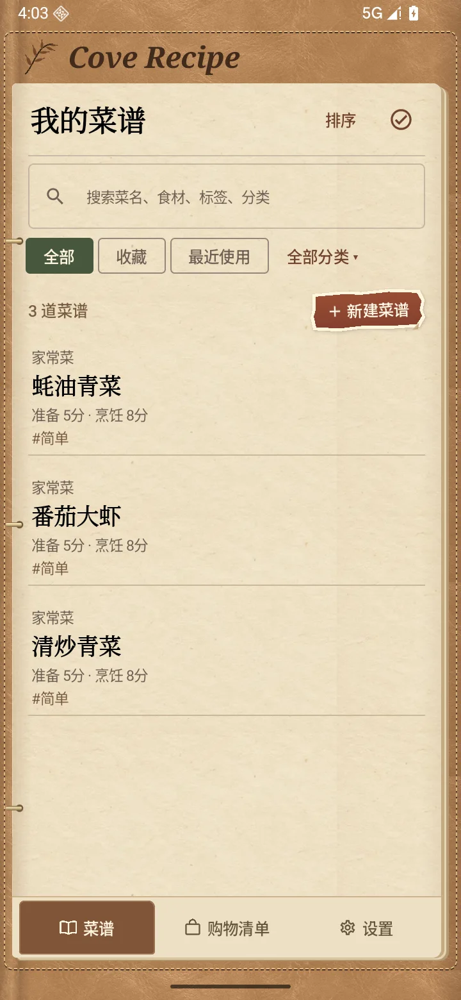
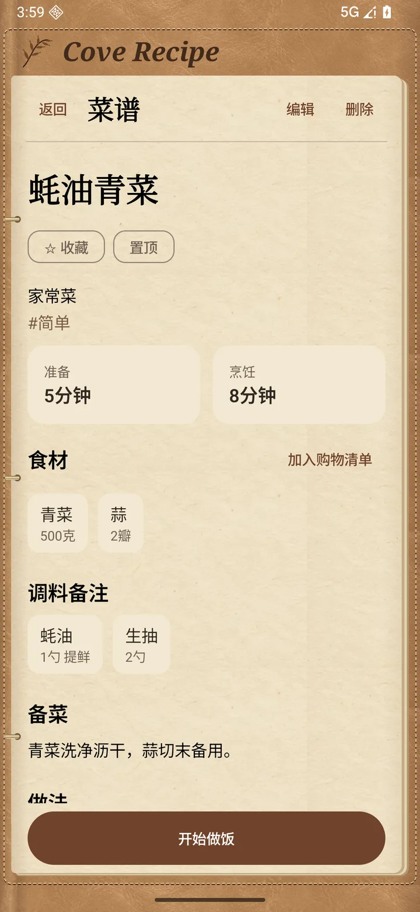
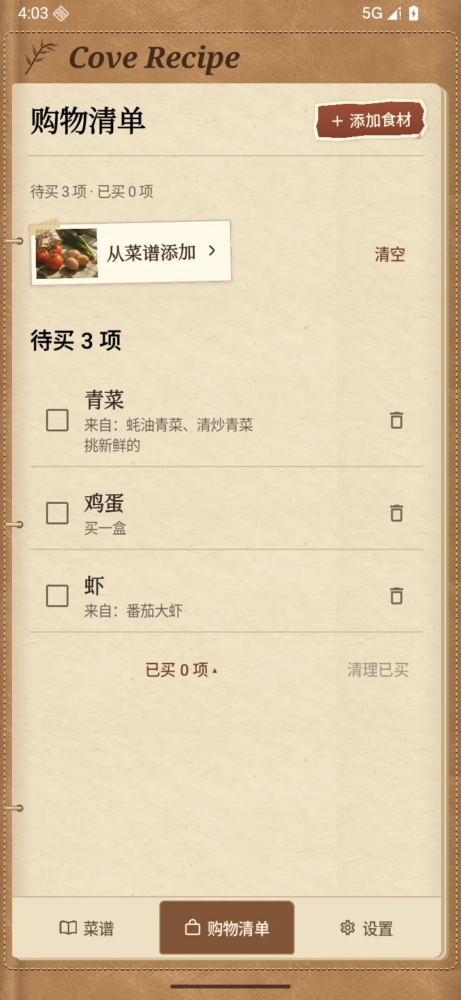
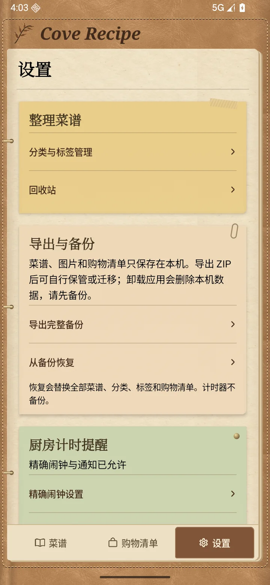
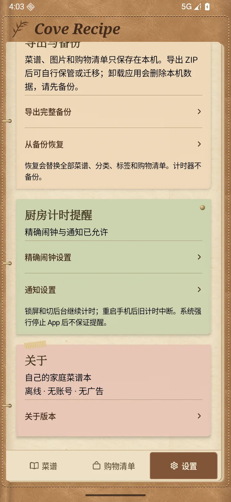
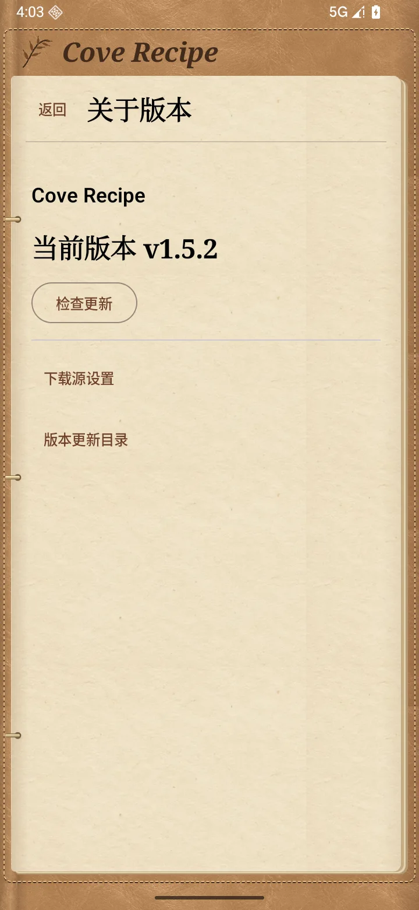

<div align="center">

简体中文 | [繁體中文](README.zh-TW.md) | [English](README.en.md)

# Cove Recipe

**中文、离线、本地优先的 Android 个人菜谱本：厨房模式、全局计时、来源追踪购物清单与 ZIP 完整备份**

[](https://github.com/vanvan-program/cove-recipe/releases/latest)
[-3DDC84?style=flat-square)](#安装与数据安全)
[](#技术栈与工程结构)
[](LICENSE)

[下载 v1.5.2 APK](https://github.com/vanvan-program/cove-recipe/releases/download/v1.5.2/CoveRecipe-1.5.2.apk) · [国内加速下载（GHFast）](https://ghfast.top/https://github.com/vanvan-program/cove-recipe/releases/download/v1.5.2/CoveRecipe-1.5.2.apk) · [发布说明与 SHA-256 校验文件](https://github.com/vanvan-program/cove-recipe/releases/tag/v1.5.2)

[更新日志](CHANGELOG.md) · [第三方组件说明](THIRD_PARTY_NOTICES.md) · [问题反馈](https://github.com/vanvan-program/cove-recipe/issues)

</div>

---

## 项目定位

Cove Recipe 是一款中文 Android 个人菜谱本，支持 Android 8.0（API 26）及以上。应用无广告，无需注册账号。菜谱、图片和购物清单只保存在手机上，记录菜谱和做饭都可以离线使用。手动检查更新或下载新版时才会联网。

## v1.5.2 更新

- 封皮换成浅驼棕皮革，选中的底部页签改为暖褐色。滑动时整张纸带着轻微倾角移出或盖回。
- 新建菜谱与添加食材采用贴纸按钮，「从菜谱添加」采用相纸按钮，设置分为四张便利贴。
- 批量清理清单后直接更新列表与数量。单独删除食材后可在数量旁撤销。

## 界面示例

以下为 Android 16 模拟器上运行 v1.5.2 的截图，使用示例菜谱。也可下载后打开[交互预览 HTML](ui-preview/cove-recipe-notebook.html)。

| 菜谱首页 | 菜谱详情 | 购物清单 |
| :---: | :---: | :---: |
| <a href="docs/screenshots/152-home.webp"></a> | <a href="docs/screenshots/152-detail.webp"></a> | <a href="docs/screenshots/152-shopping.webp"></a> |

| 设置 | 设置下半页 | 关于版本 |
| :---: | :---: | :---: |
| <a href="docs/screenshots/152-settings.webp"></a> | <a href="docs/screenshots/152-settings-bottom.webp"></a> | <a href="docs/screenshots/152-about.webp"></a> |

## 核心功能

- **结构化菜谱管理**：
  - 记录封面图（自动压缩至最长边约 1600px 并存于应用私有目录）、结构化**食材**、**调料备注**、**备菜说明**、可排序烹饪步骤、火候与步骤参考时间。
  - 支持长按拖拽自定义排序（含置顶分组与无障碍上移/下移）、最多三级自定义分类、自由标签，以及菜名 / 食材 / 标签 / 分类联合搜索、收藏、置顶与最近使用。
- **厨房模式与全局倒计时**：
  - 烹饪时启用大字体、屏幕常亮、步骤导航与食材/调料速查面板。
  - 内置全局倒计时器（小时/分钟/秒滚轮设置，1 秒至 7 天），基于单调时钟运行，支持暂停/继续/修改、通知栏实时倒计时及到点循环震动提醒。
- **可追踪来源的购物清单**：
  - 支持从单道菜谱、首页多选或购物页直接批量加入食材与调料；自动合并同名食材并保留「来自：菜名」来源标注。
  - 支持采购备注、已买勾选与删除撤销。
- **ZIP v4 完整备份与校验**：
  - 单个 ZIP 包含菜谱（含回收站）、分类、标签、购物清单和封面图片。可导入 v1、v2、v3 和 v4 格式的备份。
  - 恢复前先校验版本、引用关系、大小上限（单 JSON ≤ 16 MB、单图 ≤ 32 MB、解压总量 ≤ 256 MB）与图片合法性，事务内原子替换，失败不破坏原数据。

## 安装与数据安全

- **首次安装或从 v1.4.0 升级**　使用页首的官方或加速链接下载同一个已签名 APK。在旧版仍安装的手机上打开 APK，选择「更新」即可保留菜谱。
- **从 v1.5.0 起**　打开「设置 → 关于版本 → 检查更新」。有新版时，点「下载更新」，校验通过后点「安装更新」，并在 Android 提示中确认。 如果 v1.5.0 检查更新失败，可从页首下载 APK，保留旧应用并直接覆盖安装。
- **下载慢时**　默认从 GitHub 下载。连接超时或连续 8 秒平均速度低于 128 KiB/s 时，应用会尝试 GHFast。也可在「下载源设置」填写自建 HTTPS 镜像目录，保存后会优先使用。换源后，支持断点续传的服务器可以接着下载。
- 应用包名为 `cn.myrecipe.app`。自行构建时需使用与旧版相同的签名才能覆盖安装。可在「设置」中导出 ZIP 备份，系统云备份与设备迁移均已关闭。
- 首次使用计时器需授予「通知」与「精确闹钟」权限；锁屏与常规切后台可持续计时，手机重启后进行中的计时会标记为中断且不补响。
- 导出的 ZIP 备份未加密，请妥善保存在信任的位置。

## 技术栈与工程结构

- **技术栈**：Kotlin `2.0.21` · Jetpack Compose (BOM `2025.02.00`) · Material 3 · Room `2.6.1`（数据库 v4，支持从 v1 至 v3 迁移）· Navigation `2.8.9` · DataStore `1.1.3` · AGP `8.9.2` · Gradle `8.11.1`
- **模块划分**（单 `app` 模块）：
  - `core` — Room 数据库、图片管理、计时服务、ZIP 备份、应用内更新与主题
  - `data/repository` — 本地仓库层
  - `feature` — 菜谱、编辑、厨房模式、购物清单、分类标签与设置页面（ViewModel + StateFlow）

## 从源码构建与测试

- **环境要求**：JDK `17+` · Android SDK `36` · Gradle `8.11.1`

```powershell
git clone https://github.com/vanvan-program/cove-recipe.git
cd cove-recipe
# 配置 JDK 与 ANDROID_HOME（或 local.properties）后运行：
.\gradlew.bat :app:assembleDebug :app:testDebugUnitTest :app:lintDebug
```

- 编译成功后，调试包在 `app/build/outputs/apk/debug/app-debug.apk`。
- macOS / Linux 使用 `./gradlew` 执行相同任务；本机具备 `.tools/` 离线环境时可运行 `.\scripts\build.ps1 -Offline`（加 `-DeviceTests` 运行模拟器测试）。
- v1.5.1 的单元测试、Android lint 和 Android 15 模拟器测试均已通过。[查看构建与测试记录](https://github.com/vanvan-program/cove-recipe/actions/runs/44917329446)
- 发布新版时，用 `python scripts/release-feed.py CoveRecipe-X.Y.Z.apk updates/releases.json` 生成与签名 APK 匹配的版本清单。将同一份 `releases.json` 提交到主分支并作为 Release 附件上传，供备用线路读取。

## 开源协议

本项目采用 **[MIT License](LICENSE)** 开源，第三方依赖与许可说明见 [THIRD_PARTY_NOTICES.md](THIRD_PARTY_NOTICES.md)。
