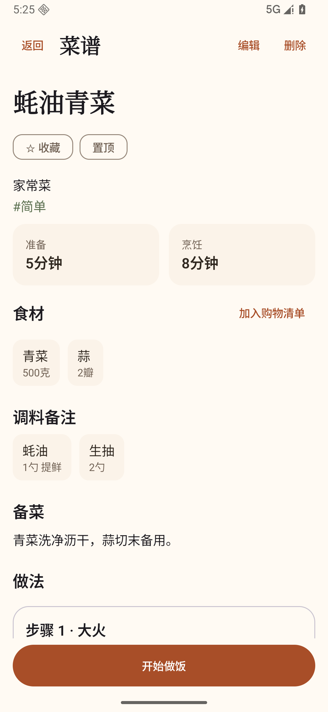

# Cove Recipe

中文、离线、本地优先的安卓个人菜谱本。最低 Android 8（API 26），编译与目标 SDK 为 Android 16（API 36）。

源码仓库：[vanvan-program/cove-recipe](https://github.com/vanvan-program/cove-recipe)。采用 [MIT License](LICENSE)，第三方依赖见 [组件说明](THIRD_PARTY_NOTICES.md)。

## 界面示例

以下为 1.4.0 专用模拟器测试截图，菜谱为测试数据。

<p>
  
  
  
</p>

## 1.4.0 更新

- 购物项在名称下方显示“来自：菜名”；多道菜的同名食材仍合并为一项，来源名称去重并自动换行。菜谱详情、首页多选和购物清单“从菜谱添加”均记录来源；采购备注、已买状态和删除撤销继续保留。来源为添加时的菜名记录，删除或重命名菜谱不改动已有清单。旧清单不推测来源。
- 菜谱卡片支持长按后上下拖动，到列表边缘自动滚动，松手保存。搜索、分类、收藏等筛选中的拖动只调整对应菜谱的位置；置顶菜谱继续排在普通菜谱之前，分别在组内调整。提供无障碍上移/下移操作，新菜谱排在所属组前面，编辑已有菜谱保留顺序。最近使用仍仅显示用过的菜谱，并使用保存的顺序。
- 在食材与备菜之间增加“调料备注”，支持与食材一致的名称、数量、单位、用量说明及增删排序，详情和厨房面板使用相同的横排卡片。可与食材一起选入购物清单。
- 数据库升级至版本 3；备份格式升级至版本 3，完整保存调料、菜谱顺序和购物来源，兼容导入格式 1 / 2。

## 1.3.0 更新

- 计时到点显示持续提醒通知，带“确认”按钮；前台提醒服务持续循环震动，确认后停止。点击通知进入厨房也可确认；开始新计时、取消或恢复备份会清理原提醒。
- 购物清单与菜谱编辑页新增食材自动聚焦名称并显示键盘。
- 食材标题简化为“食材”，详情和厨房面板横向紧凑排列、自动换行，保留原有用量。
- 厨房设置时长改为小时、分钟、秒独立上下滚轮，范围仍为 1 秒至 7 天；零时长不可确认。
- 返回应用时复用已有系统通知倒计时，减少重复重建造成的跳秒；计时与到时提醒继续使用单调时钟，不依赖应用每秒刷新通知。

## 1.2.0 更新

- 按确认的厨房手账设计调整文字层次、搜索框、菜谱卡片、详情中的时间与食材、购物清单和厨房计时面板。置顶且有封面的菜谱采用大图，无封面仍显示纯文字卡片。
- 使用提供的 Cove Recipe Logo，缩小启动图标前景，增加留白。
- 菜谱页右上角多选入口改为圆圈对勾；进入多选后显示关闭图标，保留无障碍说明和批量添加购物清单功能。
- 运行中的计时通知只展示菜名、计时状态和 28sp 剩余时间，使用系统倒计时控件持续更新；暂停时显示冻结的剩余时间。点击通知仍可返回厨房管理计时。
- 维持原有悬浮圆角矩形底栏及左右滑动切页，不增加全宽底板。

## 1.1.0 更新

- 应用更名为 Cove Recipe，使用提供的图标；包名和升级签名保持原有标识。
- 编辑页在食材与做法之间新增备菜说明；详情与厨房食材面板可查看，完整备份包含此内容。
- 菜谱、购物清单、设置可左右滑动切换，点击导航也使用同一滑动动画。
- 底栏为悬浮圆角矩形，外围无底板；内容从后方滚动，列表末尾保留操作空间。
- 新建菜谱、添加食材移至对应页面右下角；列表收藏星标仅作状态展示，详情页操作收藏。
- 无封面时隐藏图片区域；搜索框增加圆角。
- 编辑页分类选择器可直接新建并选中分类；分类弹窗显示空名称、重名及层级错误。

## 基础功能

- 菜谱增删改、内部保存的封面、结构化食材和参考用量、可排序步骤、火候与步骤参考计时。
- 最多三级自定义分类、自由标签；菜名/食材/标签/分类联合搜索、收藏、置顶、最近使用。
- 厨房模式大字体、屏幕常亮、步骤导航、查看食材；一个全局计时器，支持暂停、继续、修改、后台通知。
- 一个当前购物清单：食材名称去重、手动增删改、采购备注、已买状态、删除撤销。
- ZIP 完整备份与恢复。恢复是整库替换，先校验再写入，失败不覆盖原数据。

不含账号、网络、广告、云端同步、人数换算、评分或心得。菜谱中的数量只是参考，不会进入购物清单。

## 安装与数据

构建完成后安装 `app/build/outputs/apk/debug/app-debug.apk`；PowerShell 脚本还会复制为 `dist/CoveRecipe-1.4.0.apk`。这是用于个人试用的 debug 签名包，并非商店发行包。源码仓库不包含 APK 或签名密钥。

不同电脑生成的 debug 签名通常不同，自行构建的 APK 可能无法覆盖已有安装。请先通过应用内设置导出备份；不要为了覆盖安装而直接卸载已有应用。

升级请直接覆盖安装，保持包名 `cn.myrecipe.app` 和同一签名；不要先卸载。发布后应妥善保存签名密钥。卸载会删除本机数据，请事先在设置中导出 ZIP。系统云备份和系统设备迁移均关闭，迁移使用应用内的完整备份。

第一次使用计时器需允许通知和精确闹钟。权限未具备时不会启动看似正常、实际上无法后台提醒的计时器。授权返回后再次点开始。锁屏与普通切后台可继续计时；系统强行停止应用不保证提醒；手机重启后计时标记为中断，不补响。

## 构建与测试

使用 JDK 17 或更高版本、Android SDK 36、Gradle 8.11.1。项目已锁定 AGP 8.9.2、Kotlin 2.0.21、Compose BOM 2025.02.00、Room 2.6.1、Navigation 2.8.9 和 DataStore 1.1.3。此组合已进行实际构建验证。

本机的独立构建环境位于 `.tools/`，不进入源代码。环境准备完成后：

```powershell
.\scripts\build.ps1 -Offline
# 启动一个专用模拟器后运行设备测试（会清空模拟器中本应用的数据）
.\scripts\build.ps1 -Offline -DeviceTests
```

Android Studio 可直接打开项目。其他电脑需安装 SDK 并配置 `local.properties` 或 `ANDROID_HOME`；没有项目内 Gradle 时脚本使用 Gradle Wrapper，首次运行需要下载分发包。测试结果与限制见 `docs/1.4.0验证.md`。

首次从 GitHub 获取源码时，也可以直接使用 Gradle Wrapper（首次构建不要加 `--offline`）：

```powershell
git clone https://github.com/vanvan-program/cove-recipe.git
cd cove-recipe
# 配置 JDK 和 ANDROID_HOME，安装 Android SDK Platform 36 后：
.\gradlew.bat :app:assembleDebug :app:testDebugUnitTest :app:lintDebug
```

macOS / Linux 使用 `./gradlew` 执行相同任务。`docs/` 中保留历史验证说明与示例截图，原始本机日志、数据库快照和构建报告不纳入源码；历史说明中对应这些文件的链接仅供原本机验证留档参考。模拟器辅助脚本默认使用项目内 `.tools/sdk`，在其他电脑使用前需按本机 SDK 路径调整。

## 工程结构

单个 `app` 模块，`core` 提供 Room、图片、计时、备份及主题，`data/repository` 提供本地仓库，`feature` 按菜谱、编辑、厨房、购物、分类标签和设置分组。页面通过 ViewModel 的 StateFlow 观察 Room，偏好写入 DataStore。

数据库当前为版本 3，导出的 Room schema 纳入源码。1 → 2 显式迁移新增备菜字段；2 → 3 新增菜谱顺序、调料标记和购物来源，旧数据默认无调料/来源且保留原有排列。保留全部原有数据，不使用破坏性重建。

## 备份契约

ZIP 包含 `manifest.json`、`recipes.json`、`categories.json`、`tags.json`、`shopping.json` 与 `images/*.jpg`。格式版本当前为 3，兼容导入版本 1（备菜留空）和版本 2；旧格式缺少的调料、购物来源均留空，菜谱顺序使用原有排序。版本 3 导出包含备菜、调料、菜谱顺序和购物来源，旧版 App 无法导入新版本备份。菜谱文件内包含所属食材、步骤和标签 ID。购物清单备注与已买状态一并保存，运行中的计时器不保存。

导入拒绝未知版本、重复标识、缺失关联、循环/超过三级的分类、重复购物名称、非法图片路径、缺失图片和未知 ZIP 文件。单个 JSON 最大 16MB、单图最大 32MB、解压总量最大 256MB。图片先写入新 UUID 路径，数据库在事务中替换，失败清理新图片。无需外部存储权限。

备份为未加密文件，请保存在你信任的位置。封面导入时最长边约 1600px，保存为 JPEG；原图库照片不修改。
