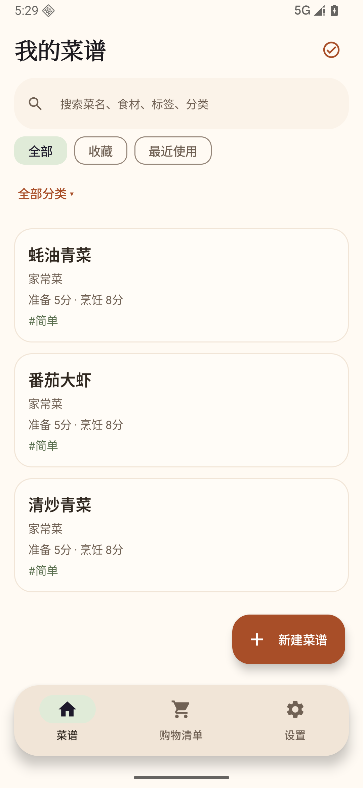
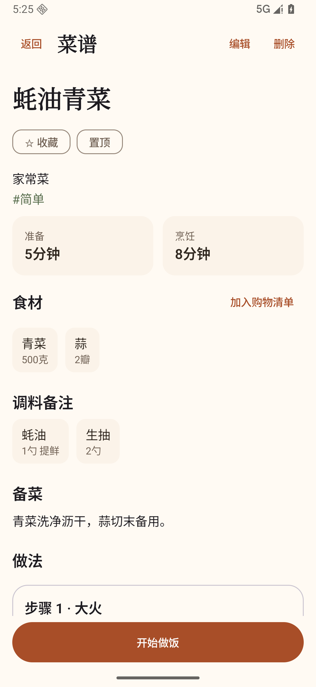
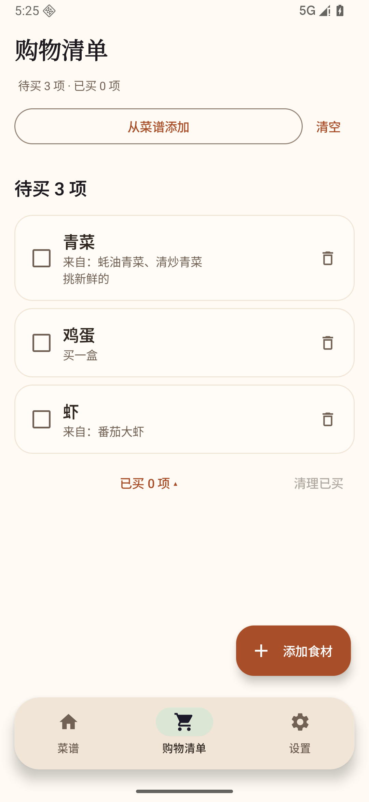

<div align="center">

[简体中文](README.md) | 繁體中文 | [English](README.en.md)

# Cove Recipe

**中文、離線、本機優先的 Android 個人食譜本：廚房模式、全域計時器、來源追蹤採買清單與 ZIP 完整備份**

[](https://github.com/vanvan-program/cove-recipe/releases/latest)
[-3DDC84?style=flat-square)](#安裝與資料安全)
[](#技術棧與專案結構)
[](LICENSE)

[下載安裝包（Releases）](https://github.com/vanvan-program/cove-recipe/releases) · [更新日誌](CHANGELOG.md) · [第三方元件說明](THIRD_PARTY_NOTICES.md) · [問題回報](https://github.com/vanvan-program/cove-recipe/issues)

</div>

---

## 專案定位

**Cove Recipe** 是一款食譜可離線使用、本機優先的 Android 個人食譜本（最低支援 Android 8 / API 26，目標 SDK 為 Android 16 / API 36）。專注於記錄與料理體驗本身：**無帳號、無廣告、無雲端同步。手動檢查版本和下載安裝檔時才使用網路**。

> [!TIP]
> 1.1.0 ～ 1.5.0 的逐版本更新說明已整理至 **[CHANGELOG.md](CHANGELOG.md)**。

## 介面預覽

以下為 1.4.0 專用模擬器測試截圖（使用測試食譜資料）：

<p>
  
  
  
</p>

## 核心功能

- **結構化食譜管理**：
  - 記錄封面圖片（自動壓縮至最長邊約 1600px 並儲存於應用程式私有目錄）、結構化**食材**、**調味備註**、**備料說明**、可排序料理步驟、火候與步驟參考計時。
  - 支援長按拖曳自訂排序（含置頂分組與無障礙上移/下移）、最多三層自訂分類、自由標籤，以及菜名 / 食材 / 標籤 / 分類聯合搜尋、收藏、置頂與最近使用。
- **廚房模式與全域倒數計時器**：
  - 料理時提供大字體、螢幕恆亮、步驟導覽與食材/調味速查面板。
  - 內建全域倒數計時器（時/分/秒滾輪設定，1 秒至 7 天），採用單調時鐘運作，支援暫停/繼續/修改、通知列即時倒數與時間到循環震動提醒。
- **可追蹤來源的採買清單**：
  - 支援從單道食譜、首頁多選或清單頁批次加入食材與調味料；自動合併同名食材並保留「來自：菜名」來源標註。
  - 支援採買備註、已購買勾選與刪除復原。
- **ZIP v3 完整備份與嚴格校驗**：
  - 單一 ZIP 封裝全部食譜、分類、標籤、採買清單與封面圖片（相容匯入格式 v1 / v2）。
  - 還原前先驗證版本、關聯完整性、容量上限（單一 JSON ≤ 16 MB、單圖 ≤ 32 MB、解壓總量 ≤ 256 MB）與圖片合法性，於資料庫交易內原子替換，失敗不影響既有資料。

## 安裝與資料安全

- 可前往 [GitHub Releases](https://github.com/vanvan-program/cove-recipe/releases) 下載安裝包，或自行建置 `app/build/outputs/apk/debug/app-debug.apk`（PowerShell 腳本會另複製為 `dist/CoveRecipe-1.5.0.apk`）。
- 應用程式套件名稱為 `cn.myrecipe.app`。升級請**直接覆蓋安裝**並維持相同簽章，切勿先解除安裝；不同電腦產生的 debug 簽章不同，更換安裝包或解除安裝前請先於設定中匯出 ZIP 備份（已關閉系統雲端備份與裝置移轉）。
- 首次使用計時器須授予「通知」與「精確鬧鐘」權限；鎖屏與一般背景運作可持續計時，手機重新啟動後進行中的計時會標記為中斷且不補響。
- 匯出的 ZIP 備份未加密，請妥善保存於信任位置。

## 技術棧與專案結構

- **技術棧**：Kotlin `2.0.21` · Jetpack Compose (BOM `2025.02.00`) · Material 3 · Room `2.6.1`（資料庫 v3，具顯式無損遷移）· Navigation `2.8.9` · DataStore `1.1.3` · AGP `8.9.2` · Gradle `8.11.1`
- **模組劃分**（單一 `app` 模組）：
  - `core` — Room 資料庫、圖片處理、計時服務、ZIP 備份契約與主題
  - `data/repository` — 本機資料儲存層
  - `feature` — 食譜、編輯、廚房模式、採買清單、分類標籤與設定頁面（ViewModel + StateFlow）

## 從原始碼建置與測試

- **環境需求**：JDK `17+` · Android SDK `36` · Gradle `8.11.1`

```powershell
git clone https://github.com/vanvan-program/cove-recipe.git
cd cove-recipe
# 設定 JDK 與 ANDROID_HOME（或 local.properties）後執行：
.\gradlew.bat :app:assembleDebug :app:testDebugUnitTest :app:lintDebug
```

- macOS / Linux 請改用 `./gradlew` 執行相同任務；本機已配置 `.tools/` 離線環境時可執行 `.\scripts\build.ps1 -Offline`（加 `-DeviceTests` 執行模擬器測試）。驗證紀錄請見 `docs/1.4.0验证.md`。

## 開源授權

本專案採用 **[MIT License](LICENSE)** 開源授權，第三方相依套件與授權聲明請見 [THIRD_PARTY_NOTICES.md](THIRD_PARTY_NOTICES.md)。
