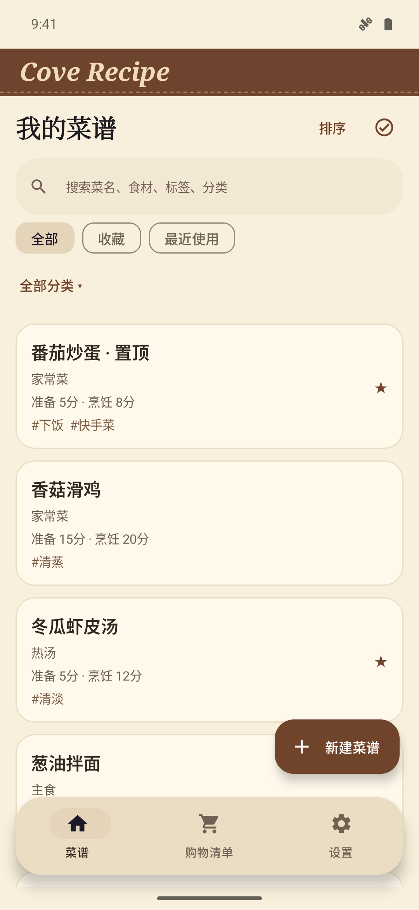
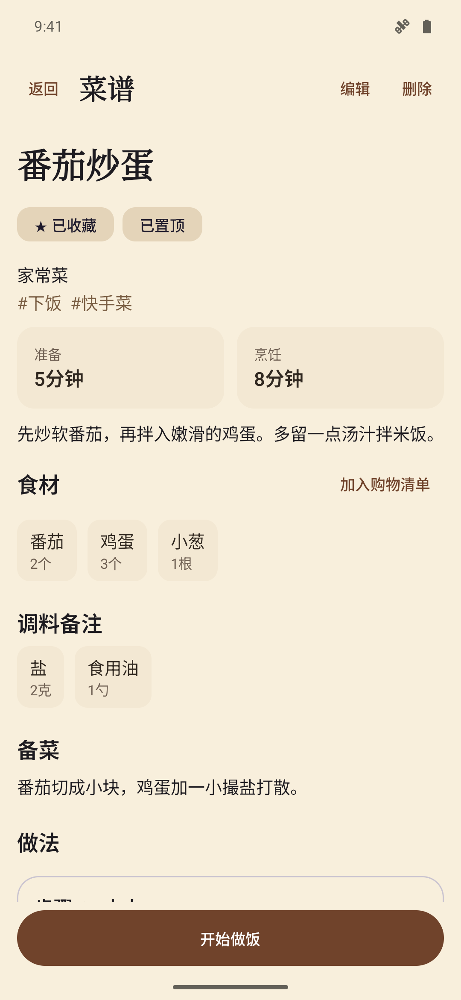
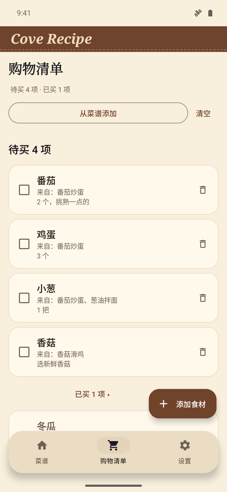
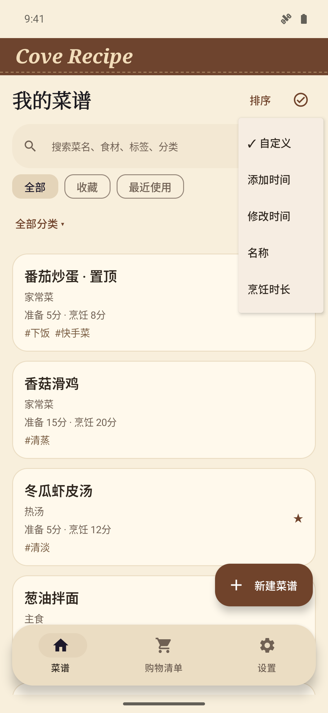
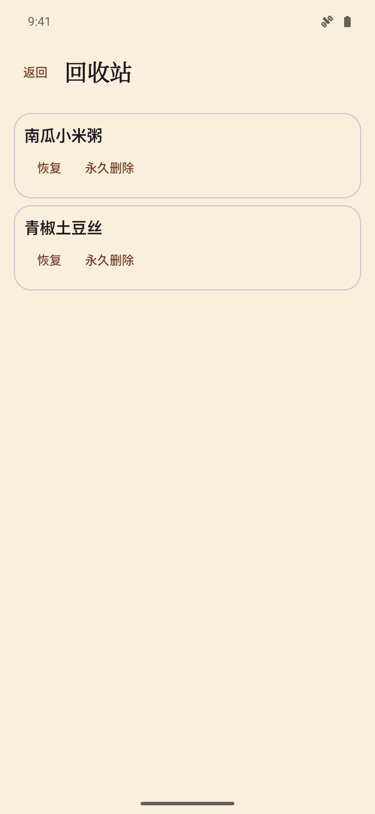
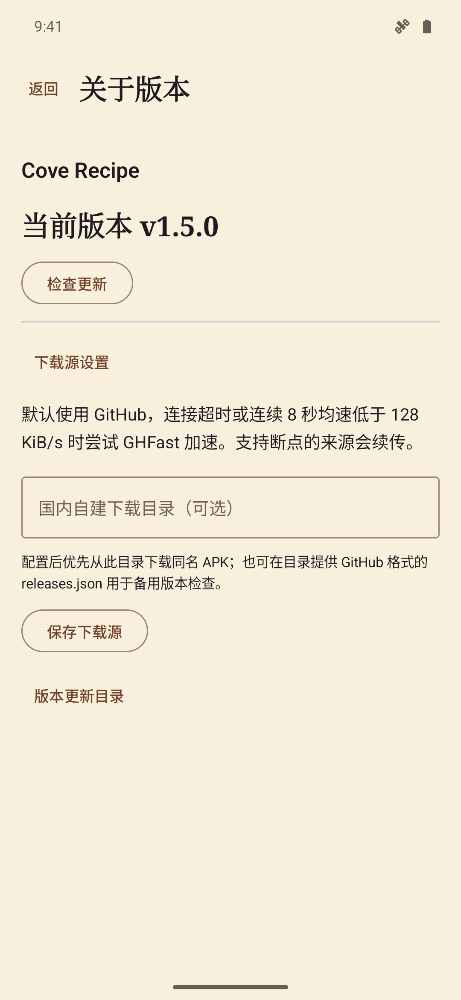

<div align="center">

[简体中文](README.md) | 繁體中文 | [English](README.en.md)

# Cove Recipe

**中文、離線、本機優先的 Android 個人食譜本：廚房模式、全域計時器、來源追蹤採買清單與 ZIP 完整備份**

[](https://github.com/vanvan-program/cove-recipe/releases/latest)
[-3DDC84?style=flat-square)](#安裝與資料安全)
[](#技術棧與專案結構)
[](LICENSE)

[下載 v1.5.0 APK](https://github.com/vanvan-program/cove-recipe/releases/download/v1.5.0/CoveRecipe-1.5.0.apk) · [加速下載（GHFast）](https://ghfast.top/https://github.com/vanvan-program/cove-recipe/releases/download/v1.5.0/CoveRecipe-1.5.0.apk) · [版本說明與 SHA-256 校驗檔](https://github.com/vanvan-program/cove-recipe/releases/tag/v1.5.0)

[更新日誌](CHANGELOG.md) · [第三方元件說明](THIRD_PARTY_NOTICES.md) · [問題回報](https://github.com/vanvan-program/cove-recipe/issues)

</div>

---

## 專案定位

Cove Recipe 是一款中文 Android 個人食譜本，支援 Android 8.0（API 26）以上版本。App 無廣告，使用時無須註冊帳號。食譜、照片和採買清單只保存在手機上，離線也能記錄食譜、跟著步驟做菜。手動檢查更新或下載新版時才會連線。

## v1.5.0 更新

- 「关于版本」會顯示目前版本，可檢查、下載及安裝更新。[查看升級步驟與下載來源說明](#安裝與資料安全)
- 首頁可依新增時間、修改時間、名稱或烹調時間排序，也可長按拖曳，自訂食譜順序。
- 誤刪食譜後，可到設定中的資源回收筒（「回收站」）還原，連同食材、調味料及步驟一併保留。
- 從食譜加入採買清單時，預設勾選食材，調味料可另外勾選。同名食材會合併，並保留來源食譜名稱。

## 介面預覽

以下畫面取自已發布的 v1.5.0 APK，在 Android 15 模擬器上以範例食譜擷取。

| 食譜首頁 | 食譜詳情 | 採買清單 |
| :---: | :---: | :---: |
| <a href="docs/screenshots/150-home.png"></a> | <a href="docs/screenshots/150-detail.png"></a> | <a href="docs/screenshots/150-shopping.png"></a> |

| 排序選單 | 資源回收筒 | 關於版本與下載來源 |
| :---: | :---: | :---: |
| <a href="docs/screenshots/150-sort.png"></a> | <a href="docs/screenshots/150-trash.png"></a> | <a href="docs/screenshots/150-about.png"></a> |

## 核心功能

- **結構化食譜管理**：
  - 記錄封面圖片（自動壓縮至最長邊約 1600px 並儲存於應用程式私有目錄）、結構化**食材**、**調味備註**、**備料說明**、可排序料理步驟、火候與步驟參考計時。
  - 支援長按拖曳自訂排序（含置頂分組與無障礙上移/下移）、最多三層自訂分類、自由標籤，以及菜名 / 食材 / 標籤 / 分類聯合搜尋、收藏、置頂與最近使用。
- **廚房模式與全域倒數計時器**：
  - 料理時提供大字體、螢幕恆亮、步驟導覽與食材/調味速查面板。
  - 內建全域倒數計時器（時/分/秒滾輪設定，1 秒至 7 天），採用單調時鐘運作，支援暫停/繼續/修改、通知列即時倒數與時間到循環震動提醒。
- **可追蹤來源的採買清單**：
  - 支援從單道食譜、首頁多選或清單頁批次加入食材與調味料；自動合併同名食材並保留「來自：菜名」來源標註。
  - 支援採買備註、已購買勾選與刪除復原。
- **ZIP v4 完整備份與驗證**：
  - 單一 ZIP 包含食譜（含資源回收筒）、分類、標籤、採買清單與封面圖片。可匯入 v1、v2、v3 和 v4 格式的備份。
  - 還原前先驗證版本、關聯完整性、容量上限（單一 JSON ≤ 16 MB、單圖 ≤ 32 MB、解壓總量 ≤ 256 MB）與圖片合法性，於資料庫交易內原子替換，失敗不影響既有資料。

## 安裝與資料安全

- **首次安裝或從 v1.4.0 升級**　從頁首的官方或加速連結下載同一個已簽章的 APK。保留手機上的舊版，開啟 APK 後選擇「更新」，即可保留食譜。
- **從 v1.5.0 起**　開啟「设置 → 关于版本 → 检查更新」。找到新版後，點選「下载更新」，驗證通過後點選「安装更新」，再依 Android 提示確認。
- **下載緩慢時**　預設從 GitHub 下載。連線逾時或連續 8 秒平均速度低於 128 KiB/s 時，App 會嘗試 GHFast。也可在「下载源设置」填入自架的 HTTPS 鏡像目錄，儲存後會優先使用。切換後，支援續傳的伺服器可從中斷處繼續下載。
- 套件名稱為 `cn.myrecipe.app`。自行建置時，必須使用與舊版相同的簽章才能覆蓋安裝。可在設定中匯出 ZIP 備份，系統雲端備份與裝置移轉均已關閉。
- 首次使用計時器須授予「通知」與「精確鬧鐘」權限；鎖屏與一般背景運作可持續計時，手機重新啟動後進行中的計時會標記為中斷且不補響。
- 匯出的 ZIP 備份未加密，請妥善保存於信任位置。

## 技術棧與專案結構

- **技術棧**：Kotlin `2.0.21` · Jetpack Compose (BOM `2025.02.00`) · Material 3 · Room `2.6.1`（資料庫 v4，可從 v1 至 v3 遷移）· Navigation `2.8.9` · DataStore `1.1.3` · AGP `8.9.2` · Gradle `8.11.1`
- **模組劃分**（單一 `app` 模組）：
  - `core` — Room 資料庫、圖片處理、計時服務、ZIP 備份、App 內更新與主題
  - `data/repository` — 本機資料儲存層
  - `feature` — 食譜、編輯、廚房模式、採買清單、分類標籤與設定頁面（ViewModel + StateFlow）

## 從原始碼建置與測試

- **環境需求**：JDK `17+` · Android SDK `36` · Gradle `8.11.1`

```powershell
git clone https://github.com/vanvan-program/cove-recipe.git
cd cove-recipe
# 設定 JDK 與 ANDROID_HOME（或 local.properties）後執行：
.\gradlew.bat :app:assembleDebug :app:testDebugUnitTest :app:lintDebug
```

- 建置成功後，偵錯版 APK 位於 `app/build/outputs/apk/debug/app-debug.apk`。
- macOS / Linux 請改用 `./gradlew` 執行相同任務；本機已配置 `.tools/` 離線環境時可執行 `.\scripts\build.ps1 -Offline`（加 `-DeviceTests` 執行模擬器測試）。
- v1.5.0 已通過單元測試、Android lint 與 Android 15 模擬器測試。[查看建置與測試紀錄](https://github.com/vanvan-program/cove-recipe/actions/runs/44909994286)

## 開源授權

本專案採用 **[MIT License](LICENSE)** 開源授權，第三方相依套件與授權聲明請見 [THIRD_PARTY_NOTICES.md](THIRD_PARTY_NOTICES.md)。
